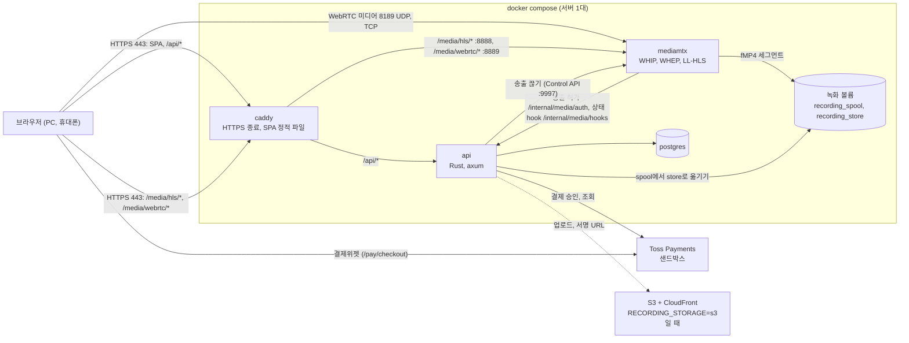

# live-platform

치지직과 같은 실시간 방송 플랫폼이다. PC는 화면 공유로, 휴대폰은 카메라로 브라우저에서 바로 송출하고, 시청자는 로그인 없이 LL-HLS나 WebRTC로 본다. 댓글, 녹화·다시보기, Toss 테스트 모드 후원을 함께 구현했다. 백엔드는 Rust(axum), 프론트는 React SPA, 미디어 서버는 MediaMTX다.

## 목차

- [서비스 주소](#서비스-주소)
- [테스트 계정과 데모 로그인](#테스트-계정과-데모-로그인)
- [실행 방법](#실행-방법)
- [기능 확인 절차](#기능-확인-절차)
- [지원 환경](#지원-환경)
- [아키텍처](#아키텍처)
- [확장 설계](#확장-설계)
- [보안 요약](#보안-요약)
- [더 읽을 문서](#더-읽을-문서)
- [Credits](#credits)

## 서비스 주소

공개 서버에서 운영하는 인스턴스는 없다. AWS 배포(#2)는 하지 않기로 했고, 검증은 로컬 `docker compose`에서만 했다([ADR infra/1 Follow-up](docs/adr/infra/1-aws-single-ec2-compose.md)).

심사는 PC 한 대에 스택을 띄워 **`https://localhost`** 에서 한다. 띄우는 방법은 [실행 방법](#실행-방법)에 있다. 운영 서버용 절차(`deploy.sh prod`, DuckDNS 도메인, Let's Encrypt)는 [`deploy/README.md`](deploy/README.md) 3~6절에 있지만 실제 서버에서 실행해 보지 않았다.

## 테스트 계정과 데모 로그인

미리 정해 둔 비밀번호 계정은 없다. 데모 로그인을 켜거나 직접 가입한다.

### 데모 로그인

`.env`에서 `DEMO_LOGIN_ENABLED=true`로 바꾸고 `bash deploy/deploy.sh local`을 다시 실행한다. api가 시작할 때 데모 계정 두 개를 만들고, `/login` 화면 아래에 **데모 계정** 버튼이 나타난다. 꺼져 있으면 버튼이 보이지 않고 `POST /api/auth/demo-login`은 404다.

> [!IMPORTANT]
> 데모 계정은 비밀번호가 없다. 위쪽 아이디·비밀번호 폼에 `demo-streamer`를 입력하면 비밀번호 칸을 채우라는 안내만 나온다. 아래 **데모 계정** 버튼을 누른다.

| 버튼 | 계정 | 쓰임 |
|---|---|---|
| **데모 방송인으로 로그인** | `demo-streamer` | 방송을 만들고 송출·종료·수정·삭제한다 |
| **데모 시청자로 로그인** | `demo-viewer` | 다른 사람의 방송에 댓글을 쓰고 후원한다 |

- 두 계정은 비밀번호가 없다(`Credential::DemoOnly`). 아이디·비밀번호 로그인으로는 들어갈 수 없고 버튼으로만 들어간다.
- 권한은 일반 계정과 같다. 소유자와 다른 사용자를 함께 보려면 브라우저 창 두 개(예: 일반 창과 시크릿 창)에서 각각 로그인한다.
- 데모 로그인은 클라이언트(IP)당 분당 10회로 제한한다.
- 매일 초기화한다. reaper가 데모 계정의 방송 중 한국 시간 오늘 0시 전에 만들었고 `READY`·`ENDED` 상태인 것을 soft delete한다. 방송 중인 방송은 끝난 뒤에 지운다. 세션은 그대로 둬서 쓰는 중에 로그아웃되지 않는다([ADR common/27](docs/adr/common/27-request-limits-housekeeping.md)).

### 회원가입

상단의 **회원가입**(`/signup`)에서 아이디와 비밀번호를 넣는다. 가입하면 바로 로그인된다.

- 아이디는 영문 소문자, 숫자, `_`, `-` 로 3~20자다. `demo-`로 시작하는 아이디는 데모 계정용으로 막아 두었다.
- 비밀번호는 10~128자다. 유출 비밀번호 목록에 있는 값은 거부한다.
- 가입은 클라이언트당 2분에 5회까지다.

## 실행 방법

필요한 것은 Docker Engine과 Compose v2(`docker compose version`), `bash`(Windows는 Git Bash), `openssl`이다. 포트 80, 443(tcp, udp), 8189(udp, tcp)가 비어 있어야 한다.

저장소 루트에서 `.env`를 만들고 스택을 띄운다.

```bash
cp .env.example .env
# 송출 JWT 서명 키와 MediaMTX 공유 비밀값은 로컬에서도 있어야 API가 뜬다
sed -i.bak "s|^PUBLISH_JWT_PRIVATE_KEY=.*|PUBLISH_JWT_PRIVATE_KEY=$(openssl rand -base64 32)|" .env && rm .env.bak
sed -i.bak "s|^MEDIA_HOOK_SECRET=.*|MEDIA_HOOK_SECRET=$(openssl rand -hex 32)|" .env && rm .env.bak
# 선택: 데모 로그인 버튼
sed -i.bak "s|^DEMO_LOGIN_ENABLED=.*|DEMO_LOGIN_ENABLED=true|" .env && rm .env.bak
bash deploy/deploy.sh local
```

`ok: https://localhost is up (<커밋>)`이 나오면 준비가 끝난 것이다. `deploy.sh`는 `docker compose up -d --build --wait`로 caddy, api, mediamtx, postgres를 빌드해 띄우고, Caddy를 거쳐 `https://localhost/api/healthz`가 `ok`를 돌려주는지 확인한다. api는 시작할 때 DB 마이그레이션을 적용하므로 시드 데이터는 필요 없다.

브라우저에서 `https://localhost`를 열면 인증서 경고가 나온다. Caddy가 내부 CA로 인증서를 발급하기 때문이다. 경고에서 계속 진행한다. 로컬은 이 경고를 넘길 수 있도록 HSTS를 끄고 띄운다.

`.env.example`의 키는 다음과 같다. 위 명령이 바꾸지 않는 값은 로컬에서 그대로 둬도 동작한다.

| 키 | 로컬에서 | 설명 |
|---|---|---|
| `POSTGRES_DB`, `POSTGRES_USER`, `POSTGRES_PASSWORD` | 그대로 | 외부 포트가 없는 compose 내부 DB |
| `PUBLISH_JWT_PRIVATE_KEY` | 필수 | 송출 토큰(EdDSA) 서명 키. `openssl rand -base64 32` |
| `MEDIA_HOOK_SECRET` | 필수 | MediaMTX가 api의 `/internal/media/*`를 부를 때 내는 공유 비밀값. `openssl rand -hex 32` |
| `DEMO_LOGIN_ENABLED` | 선택 | `true`면 데모 계정 버튼 |
| `TOSS_CLIENT_KEY`, `TOSS_SECRET_KEY` | 후원을 확인할 때 | Toss 테스트 키. 둘 다 비우면 후원이 꺼진다. [후원](#후원)을 본다 |
| `RECORDING_STORAGE`, `S3_*`, `CLOUDFRONT_*` | 비움 | 비우면 녹화를 api 쪽 `recording_store` 볼륨에 둔다 |
| `ACME_EMAIL`, `DOMAIN`, `PUBLIC_IP`, `RECORDING_MEDIA_ORIGIN` | 그대로 | 운영 오버레이(`compose.prod.yml`)에서만 쓴다 |

`.env` 값을 바꾼 뒤에는 `bash deploy/deploy.sh local`을 다시 실행한다. 설정이 바뀐 컨테이너만 다시 만든다. 상태와 로그는 `docker compose ps`, `docker compose logs -f api`로 본다. 개발 환경(`cargo`, `npm run dev`)과 테스트 명령은 [`docs/DEVELOPMENT.md`](docs/DEVELOPMENT.md)와 [`web/README.md`](web/README.md)에 있다.

## 기능 확인 절차

### 자동 확인

실제 스택에 헤드리스 Chrome(Playwright)을 붙여 사용자처럼 버튼을 누르는 검증 스크립트가 있다. 시스템 Chrome과 Node가 필요하다.

```bash
bash .claude/skills/verify-live-platform/scripts/setup.sh     # 한 번: playwright-core 설치, Chrome 확인
bash .claude/skills/verify-live-platform/scripts/launch.sh    # 현재 체크아웃을 deploy.sh local로 빌드해 띄운다
bash .claude/skills/verify-live-platform/scripts/run-all.sh   # 약 5분, 끝에 ALL OK
```

`run-all.sh`는 시청(`watch`), 송출(`publish`, 휴대폰 에뮬레이션 포함), 댓글(`comments`), 녹화(`recording`), 후원(`donation`) 순서로 돌고, 마지막에 `deploy/check-hardening.sh local`로 보안 헤더와 컨테이너 설정을 확인한다. `donation`은 `.env`의 Toss 테스트 키와 인터넷 연결이 필요하다. 기능마다 무엇을 확인하는지는 [`features/README.md`](.claude/skills/verify-live-platform/features/README.md)에 있다. 증거(로그, 스크린샷, PASS/FAIL 표)는 저장소 밖 `~/.cache/verify-live-platform/evidence/`에 남는다.

### 손으로 확인하기

창을 세 개 연다. 같은 브라우저의 시크릿 창들은 세션 하나를 나눠 쓰므로 비로그인 창은 다른 브라우저로 연다.

| 창 | 시점 | 준비 |
|---|---|---|
| A | 소유자 | `로그인` → **데모 방송인으로 로그인** (또는 가입한 계정 1) |
| B | 다른 사용자 | 시크릿 창에서 **데모 시청자로 로그인** (또는 가입한 계정 2) |
| C | 비로그인 | 다른 브라우저에서 `https://localhost` |

시점마다 보이는 것은 다음과 같다. 화면에 버튼이 없는 동작은 서버도 유스케이스에서 막는다.

| 기능 | 비로그인 | 소유자 | 다른 사용자 |
|---|---|---|---|
| 방송 목록, 상세, 시청 | 된다 | 된다 | 된다 |
| 방송 만들기 | 홈에 `방송 만들기` 버튼이 없다 | 된다 | 자기 방송으로 된다 |
| `방송 시작` / `방송 종료` | 없다 | 있다 | 없다 |
| `수정` / `삭제` | 없다 | 있다. 삭제는 `준비`·`종료` 상태에서만 된다 | 없다 |
| 댓글 | 읽기만 ("댓글을 쓰려면 로그인하세요.") | 쓰기, 자기 댓글 수정·삭제, `슬로우 모드` 설정 | 쓰기, 자기 댓글만 수정·삭제 |
| 후원 | 합계와 목록만 본다 | 자기 방송에는 후원 폼이 없다 | 방송 중일 때 후원한다 |
| 다시보기 | 된다 | 된다 | 된다 |

#### PC 화면 공유 송출

1. 창 A의 홈(`/`)에서 `방송 만들기`를 누른다.
2. `/broadcasts/new`에서 `제목`(100자까지)과 `설명`을 넣고 `만들기`를 누른다. 상세 페이지 `/broadcasts/<id>`로 이동하고, 배지는 `준비`, 화면에는 "아직 방송 전입니다."가 보인다.
3. `송출 방식`에서 `화면`(기본)을 고르고 `방송 시작`을 누른다.
4. 브라우저 공유 창에서 탭이나 화면을 고른다. 탭 소리도 보내려면 공유 창에서 오디오 공유를 켠다. 마이크 권한을 허용하면 마이크 소리를 섞어 보낸다.
5. 상태 문구가 `송출 중 · <kbps> · <가로x세로>`가 되고 배지가 `방송 중`으로 바뀐다. 송출은 720p, 30fps, 2.5Mbps를 넘지 않게 브라우저에서 제한한다.

PC에서 `카메라`를 고르면 웹캠과 마이크로 송출한다. PC는 탭을 숨겨도 송출을 이어 간다.

#### 모바일 카메라 송출

휴대폰에서는 PC의 `localhost`에 닿을 수 없다. 두 가지 방법이 있다.

**PC에서 휴대폰 흉내 내기.** 웹캠이 있는 PC의 Chrome에서 방송 상세 페이지를 열고, 개발자 도구의 기기 툴바(`Ctrl+Shift+M`)에서 Pixel 7 같은 휴대폰을 고른 뒤 새로 고침한다. 휴대폰은 UA로 판별하므로 `송출 방식` 선택 없이 카메라만 나온다. `카메라 전환 (전면 카메라)` 버튼으로 전면·후면을 바꾼다. 방송 중에 바꿔도 시청자 연결은 끊기지 않는다. 자동 확인의 `publish`가 같은 방식(Playwright의 Pixel 7 에뮬레이션)으로 송출, 카메라 전환, 백그라운드 일시정지와 복귀를 확인한다.

**실제 휴대폰.** 브라우저는 HTTPS에서만 카메라를 연다. 기본 `compose.yml`은 Caddy 사이트 주소, API 허용 출처, WebRTC 후보 주소가 모두 `localhost`에 맞춰져 있다. 같은 Wi-Fi의 휴대폰이 PC에 붙으려면 이 세 값을 PC의 LAN IP로 바꿔 띄워야 한다. 세 값을 바꾸는 파일은 운영 오버레이 `compose.prod.yml`이므로, `DOMAIN`과 `PUBLIC_IP`에 IP를 넣고 compose를 직접 부른다. `deploy.sh prod`는 `.env`에 `change-me`가 남아 있으면 멈추기 때문에 쓰지 않는다.

```bash
# <PC_IP>: PC의 LAN IPv4 (Windows는 ipconfig의 Wi-Fi IPv4 주소)
DOMAIN=<PC_IP> PUBLIC_IP=<PC_IP> docker compose -f compose.yml -f compose.prod.yml up -d --build --wait
# 휴대폰에 설치할 Caddy 내부 CA 루트 인증서 (Git Bash는 앞에 MSYS_NO_PATHCONV=1)
docker compose cp caddy:/data/caddy/pki/authorities/local/root.crt ./caddy-root.crt
```

1. Windows 방화벽이 물으면 Docker의 443/tcp, 8189/udp, 8189/tcp 수신을 허용한다.
2. `caddy-root.crt`를 휴대폰에 설치한다. iOS는 프로필을 설치한 뒤 설정 > 일반 > 정보 > 인증서 신뢰 설정에서 켠다. Android는 설정 > 보안 > 인증서 설치 > CA 인증서로 설치한다.
3. PC와 휴대폰 모두 `https://<PC_IP>`로 연다. API가 이 출처만 허용하므로 이 동안에는 PC에서도 `https://localhost` 대신 이 주소를 쓴다. 운영 오버레이가 HSTS를 켜지만 브라우저는 IP 주소에 HSTS를 적용하지 않는다(RFC 6797 8.1.1).
4. 휴대폰에서 로그인하고 방송을 만든 뒤 `방송 시작`을 누르고 카메라·마이크 권한을 허용한다.
5. 끝나면 `bash deploy/deploy.sh local`로 되돌리고, 휴대폰의 인증서 프로필과 `caddy-root.crt`를 지운다. 인증서 파일은 커밋하지 않는다.

이 방식은 미디어 PoC(#3, [`docs/poc/3-media-device-check.md`](docs/poc/3-media-device-check.md))에서 iPhone 15 Pro Safari의 카메라 송출과 WHEP 시청으로 확인했다. 지금 앱은 #9에서 iPhone 15 Pro Safari로 송출, 카메라 전환, 화면 잠금 후 복귀와 종료를 확인했다. Android는 실기기가 없어 Pixel 7 에뮬레이션으로만 확인했다.

휴대폰으로 송출할 때 알아 둘 것은 다음과 같다.

- 화면이 꺼지거나 다른 앱으로 가면 송출을 멈추고, 방송은 `연결 끊김`(INTERRUPTED)이 된다. 30초 안에 돌아오면 자동으로 다시 송출한다. 30초가 지나면 방송이 `종료`된다.
- 방송 중에 휴대폰을 돌리면 해상도가 바뀌어, 이미 LL-HLS로 보던 시청자 화면이 멈출 수 있다. 방향을 정한 뒤 시작한다.

#### 시청

1. 창 C(비로그인)나 창 B의 홈에서 `방송 중` 목록의 제목을 누른다. `/broadcasts/<id>`를 바로 열어도 된다.
2. 플레이어가 음소거로 자동 재생하고 `LL-HLS로 재생 중`을 보여 준다. `소리 켜기`로 소리를 켠다.
3. `저지연(WebRTC)`을 체크하면 WHEP로 다시 연결하고 `WebRTC로 재생 중`이 된다. iPhone과 iPad에는 이 토글이 없고 처음부터 WebRTC로 본다.
4. 한 소스가 실패하면 다음 소스로 넘어간다. 모두 실패하면 "영상을 재생하지 못했습니다."와 `다시 시도`가 나온다.

상세 페이지는 약 5초마다 상태를 다시 묻는다. 송출이 끊기면 플레이어 대신 "방송 연결이 끊겼습니다. 다시 연결되면 이어서 볼 수 있습니다."가 나온다.

#### 종료

1. 창 A에서 `방송 종료`를 누른다. 브라우저 공유 바에서 화면 공유를 중지해도 종료된다.
2. 배지가 `종료`가 된다. 시청 창은 5초 안에 "종료된 방송입니다."로 바뀌고 플레이어가 사라진다. 홈에서는 `지난·예정 방송` 목록으로 옮겨 간다.

종료는 DB에 `ENDED`를 커밋한 뒤 MediaMTX의 송출 세션을 끊는다. 네트워크가 끊겨 송출만 사라진 경우는 종료가 아니라 `연결 끊김`이다. 30초 안에 `방송 시작`을 다시 누르면 같은 방송이 이어지고, 30초가 지나면 서버가 `종료`로 바꾼다.

#### 댓글

1. 창 B에서 방송 상세 페이지 아래 `댓글` 입력란에 글을 쓰고 `등록`을 누른다. 500자까지이고 `n/500`으로 글자 수를 보여 준다.
2. 창 A와 C에 새로 고침 없이 나타난다(SSE).
3. 자기 댓글에만 `수정`과 `삭제`가 있다. 수정한 댓글에는 `(수정됨)`이 붙는다.
4. 한 사용자는 1초에 1건까지 쓴다. 너무 빨리 쓰면 "…초 후 다시 쓸 수 있습니다."가 나온다.
5. 창 A(소유자)에서 `슬로우 모드`를 고르면(끔, 3초~300초) 다른 사용자의 쓰기 간격이 늘어난다. 소유자는 적용받지 않는다.
6. `<script>`를 써도 글자로만 보이고 실행되지 않는다. 종료된 방송에는 댓글을 쓸 수 없다.

#### 녹화와 다시보기

1. MediaMTX가 모든 방송을 30분 단위 fMP4로 녹화한다. 짧은 방송은 `방송 종료`를 눌러야 구간이 닫혀 녹화가 생긴다.
2. 종료한 방송의 상세 페이지 `다시보기` 목록이나 상단 `다시보기`(`/recordings`)의 녹화 목록에서 녹화를 누른다.
3. `/recordings/<id>`에서 재생하고 원하는 위치로 옮겨 본다. 비로그인도 볼 수 있다.

녹화 파일 주소는 5분 동안 유효한 서명 URL이다. 서명을 바꾼 주소는 403이다. 방송을 삭제하면 다시보기와 이미 받은 파일 주소가 모두 404가 된다.

#### 후원

후원은 Toss Payments 테스트 모드로만 동작한다. 실제 돈은 나가지 않는다.

1. [Toss Payments API 키 문서](https://docs.tosspayments.com/reference/using-api/api-keys)에서 테스트 키를 받는다. 결제위젯 클라이언트 키(`test_gck_`로 시작)와 시크릿 키(`test_gsk_`로 시작)가 필요하다. 개발자센터에 가입하면 내 테스트 키를 쓸 수 있다.
2. `.env`에서 `# TOSS_CLIENT_KEY=`, `# TOSS_SECRET_KEY=` 두 줄의 `#`을 지우고 값을 넣은 뒤 `bash deploy/deploy.sh local`을 다시 실행한다. 서버는 `test_`로 시작하지 않는 키나 한쪽만 넣은 키를 받으면 시작하지 않는다. 키가 없으면 후원을 눌렀을 때 "지금은 후원을 받지 않습니다."가 나온다.
3. 창 A에서 방송을 `방송 중`으로 만든다.
4. 창 B에서 그 방송의 `후원` 영역에서 `5,000원` 같은 금액 버튼을 누르거나 1,000원~1,000,000원을 넣고 `후원하기`를 누른다.
5. `/pay/checkout`의 Toss 결제위젯에서 `결제하기`를 누르고 샌드박스 결제창을 끝까지 진행한다.
6. `/pay/success`에 "5,000원을 후원했습니다. 고맙습니다!"가 나온다.
7. 창 A와 C의 `후원` 영역에 "<아이디>님이 5,000원을 후원했습니다!"가 뜨고 합계(`5,000원 · 1건`)가 바로 바뀐다.

같은 결제 확인이 여러 번 와도 한 번만 적립한다. 한 사용자는 3초에 1건까지 주문한다. 자동 확인은 샌드박스 기본 흐름(계좌 간편이체)으로만 통과했고, 카드 결제 완료와 `/pay/fail` 화면은 확인하지 않았다.

## 지원 환경

### 브라우저

| 환경 | 송출 | 시청 | 확인한 범위 |
|---|---|---|---|
| PC Chrome | 화면 공유(`getDisplayMedia`, 탭 소리 + 마이크) 또는 웹캠 | LL-HLS(hls.js, MSE) 기본, WebRTC(WHEP) 토글 | 헤드리스 Chrome 자동 확인. Windows Chrome 화면 공유는 #3 PoC에서 실사용 |
| Android Chrome | 카메라 + 마이크, 전면·후면 전환 | LL-HLS 기본, WebRTC 토글 | Playwright Pixel 7 에뮬레이션(UA·뷰포트·터치·가짜 카메라)으로 송출, 전환, 백그라운드, 반응형 확인. 실기기는 없어서 확인하지 않았다(#9) |
| iOS·iPadOS Safari | 카메라 + 마이크, 전면·후면 전환 | WebRTC(WHEP)만, 저지연 토글 없음 | 실기기 iPhone 15 Pro Safari에서 송출(영상·음성), 전면·후면 전환, 백그라운드 30초 안 복귀와 30초 뒤 종료, 방송 종료, 세로·가로 화면 확인(#9). iPad는 미확인 |

- 송출(화면 공유, 카메라)은 HTTPS 같은 보안 출처에서만 된다. `http://`로 열면 "이 브라우저에서는 송출할 수 없습니다. HTTPS 주소로 접속했는지 확인하세요."가 나온다.
- 휴대폰 판별은 `navigator.userAgentData.mobile`, iOS·iPadOS UA, Android UA로 한다(`web/src/broadcasts/platform.ts`). Android Chrome의 "데스크톱 사이트" 모드는 PC로 보인다.
- 브라우저 내장 HLS는 쓰지 않는다. PoC에서 Chrome과 iOS Safari 모두 이 스트림을 디코딩하지 못했다. 그래서 iOS는 WHEP만 쓴다([ADR media/8](docs/adr/media/8-playback-player.md)).
- Firefox, Edge, macOS Safari는 확인하지 않았다.

### 서버와 개발 도구

| 항목 | 요구 사항 |
|---|---|
| Docker | Docker Engine, Compose v2 (`docker compose`) |
| 포트 | 80/tcp, 443/tcp, 443/udp(HTTP/3), 8189/udp·tcp(WebRTC 미디어) |
| 컨테이너 자원 상한 합 | CPU 2.5개, 메모리 약 2.4GB (`compose.yml`) |
| Rust (개발할 때만) | 1.99.1 (`rust-toolchain.toml`), edition 2024 |
| Node (개발할 때만) | 24 (`web/.nvmrc`, `engines.node >=24`) |

이미지 안에서 빌드하므로 스택을 띄우는 데는 Rust와 Node가 필요 없다.

## 아키텍처

### 서비스 구성

서버 한 대에 docker compose로 네 서비스를 띄운다. 밖으로 열린 것은 Caddy(80, 443)와 MediaMTX의 WebRTC 미디어 포트(8189)뿐이다. api, Postgres, MediaMTX Control API는 compose 내부망에만 있다.



송출 한 번의 흐름은 다음과 같다.

1. 소유자가 `방송 시작`을 누르면 api(`POST /api/broadcasts/{id}/start`)가 조건부 UPDATE로 방송을 `LIVE`로 바꾸고 60초짜리 1회용 송출 JWT(EdDSA)를 준다.
2. 브라우저가 그 토큰으로 `/media/webrtc/.../whip`에 WHIP 요청을 보낸다. MediaMTX는 api의 `/internal/media/auth`에 허가를 묻고, api는 서명, 경로, 소유자, 방송 상태를 확인한 뒤 `jti`를 소비한다.
3. 송출이 끊기면 MediaMTX hook이 api에 알리고 방송은 `INTERRUPTED`가 된다. 다시 송출하면 `LIVE`로 돌아온다. 30초 안에 돌아오지 않으면 5초마다 도는 reaper가 `ENDED`로 바꾸고 남은 송출을 끊는다.
4. 시청자는 `GET /api/broadcasts/{id}/playback`으로 LL-HLS와 WHEP 주소를 순서대로 받아 재생한다.
5. 녹화 구간이 끝나면 hook이 api에 알리고, api가 파일을 녹화 저장소로 옮긴 뒤 `READY`로 표시한다.

방송 상태는 `READY → LIVE ⇄ INTERRUPTED(30초 유예) → ENDED`다. 모든 상태 전이는 `UPDATE ... WHERE id = $1 AND owner_id = $2 AND status IN (...)` 한 문장으로 하고, 영향받은 행이 0이면 409, 403, 404 중 하나로 답한다.

### 코드 구조

Cargo workspace 네 crate로 나눈 Hexagonal(Ports & Adapters) 구조다. 의존은 안쪽으로만 향하고, `scripts/check-layer-deps.sh`가 CI에서 `domain`과 `application`의 의존성을 허용 목록과 비교한다.

| crate | 역할 | 의존할 수 있는 crate |
|---|---|---|
| `domain` | 엔티티, 값 객체, 상태 머신, 도메인 에러 | 없음 (`thiserror`만) |
| `application` | 유스케이스, port trait | `domain` |
| `infrastructure` | sqlx, MediaMTX, S3, Toss, JWT adapter | `domain`, `application` |
| `api` | axum handler, DTO, DI 조립(`main`) | 모두 |

- `domain`과 `application`에는 AWS, MediaMTX, Postgres, axum 같은 인프라 이름이 나오지 않는다.
- port는 작게 나눈다. 예를 들어 미디어는 `IngestRouter`, `PublishAuthorizer`, `PlaybackResolver`, `StreamTerminator`로 나뉜다. 주입은 `Arc<dyn Trait>`다.
- API 계약은 utoipa가 핸들러에서 만든 OpenAPI(`/api/openapi.json`)이고, 웹 클라이언트 타입은 그 명세에서 생성한다.
- ID는 Snowflake `BIGINT`이고 JSON에서는 문자열이다.

설계 결정과 그 이유는 [ADR 목록](docs/adr/README.md)에 기능별로 있다.

## 확장 설계

구현은 서버 한 대지만, 평상시 동시 시청 약 130만, 이벤트 피크 500만을 가정하고 구조를 나눴다. 숫자는 설계 방향을 정하려고 세운 추정이다.

| 구분 | 방송인 | 평균 동시 시청 |
|---|---|---|
| 소형 | 약 1,000 | 1,000 이하 |
| 중형 | 약 100 | 약 5,000 |
| 대형 | 약 25 | 약 20,000 |
| 이벤트 피크 | | 합계 500만 |

피크 시청 대역은 약 15Tbps다. 서버 한 대로는 낼 수 없고 WebRTC SFU로는 노드가 수천 대 필요하다. 그래서 기본 시청 방식을 CDN에 얹을 수 있는 LL-HLS로 정했고, WebRTC는 저지연이 필요한 시청자만 고른다.

서비스는 다섯 plane으로 나누고 plane마다 따로 늘린다.

| plane | 무엇에 비례하나 | 지금 | 확장할 때 |
|---|---|---|---|
| Control (api) | API 요청 수 | api 1개, 세션과 상태는 Postgres | 로드 밸런서 뒤 N개 |
| Ingest | 송출자 수 | MediaMTX 1개 (`IngestRouter`) | 미디어 노드 풀과 노드 배정 |
| Delivery | 시청자 수 | MediaMTX가 LL-HLS, WHEP를 직접 냄 (`PlaybackResolver`) | LL-HLS 오리진 + CDN, 선택적 트랜스코딩 |
| Realtime | 댓글을 보는 시청자 수 | SSE + Postgres `LISTEN/NOTIFY` (`EventBus`), 200ms 묶음 | SSE 게이트웨이 N개, Redis나 NATS |
| Data | 읽기 요청 수 | Postgres 1개, 쓰기 Repository와 읽기 Query port 분리 | primary + replica, 캐시 |

다중 노드, CDN 라이브 전달, 트랜스코딩은 port와 경계만 두고 구현하지 않았다. 가정에서 나온 수치, 인스턴스 밖으로 뺀 상태와 port, 댓글 저장 확장 단계는 [`docs/capacity-plan.md`](docs/capacity-plan.md)에 있다.

## 보안 요약

원칙은 deny by default다. 허용할 경로만 열고, 인가는 handler가 아니라 유스케이스에서 한다. 위협(S1~S10)마다 막는 코드와 그 테스트는 [`SECURITY.md`](SECURITY.md)에 있다.

| 영역 | 하는 일 |
|---|---|
| 로그인과 세션 | argon2id 해시(`spawn_blocking`과 세마포어로 동시 실행 수 제한), 비밀번호 10자 이상과 유출 목록 거부. 256bit 세션 토큰은 SHA-256만 저장하고 `__Host-` HttpOnly Secure SameSite=Lax 쿠키로 준다. 유휴 30분, 최대 7일, 로그인할 때마다 새로 발급. 없는 계정과 틀린 비밀번호는 같은 에러다 |
| CSRF | 상태를 바꾸는 `/api` 요청은 허용된 `Origin`과 정확히 같고 `X-Requested-With: live-platform` 헤더가 있어야 한다 |
| 인가 | 소유자 확인과 실행을 조건부 UPDATE 한 문장으로 한다. 요청 DTO는 `owner_id`, `status`, `version`을 받지 않는다. 수정 충돌은 `If-Match`와 `version`으로 막는다. SQL은 sqlx 바인딩만 쓴다 |
| 송출 | 60초짜리 EdDSA JWT는 방송 경로 하나에만 쓰이고 `jti`로 한 번만 쓰인다. MediaMTX가 송출마다 api에 허가를 묻는다. hook 경로 `/internal/*`은 Caddy가 밖으로 내지 않고, 공유 비밀값을 상수 시간으로 비교한다 |
| 결제 | 금액이 주문과 다르면 Toss를 부르지 않는다. 승인은 주문마다 같은 `Idempotency-Key`로 하고, `PENDING`에서 한 번만 적립한다. `payment_key`는 UNIQUE다. webhook 본문은 믿지 않고 Toss 조회 API로 다시 확인한다. `test_` 키만 받는다 |
| 녹화 | 파일은 5분 서명 URL(로컬 HMAC-SHA256, CloudFront ECDSA P-256)로만 내준다 |
| 브라우저 헤더 | CSP `script-src 'self'`(인라인 스크립트 없음), `frame-ancestors 'none'`, `X-Content-Type-Options`, `Referrer-Policy`, `Permissions-Policy`, `Server` 헤더 제거. Toss를 허용하는 넓은 CSP는 `/pay` 문서에만 준다. 운영 HSTS는 1년 |
| 남용 | 로그인 IP당 분당 10회·아이디당 분당 5회, 가입 2분에 5회, 댓글 사용자당 1초에 1건과 슬로우 모드, SSE 클라이언트당 20개, 후원 주문 3초에 1건, 사용자당 진행 중 방송 1개. API 요청 10초, 본문 64KB, Caddy 헤더 10초·본문 30초 |
| 로그와 에러 | 에러 응답은 `{code, message, traceId}`만 담는다. 비밀값은 `Secret<T>`로 감싸 로그에 나오지 않는다. 로그인 실패, 403, 송출 끊기, 결제는 감사 로그(target `audit`)에 남긴다 |
| 컨테이너와 공급망 | 모든 서비스가 non-root, read-only rootfs, `cap_drop: ALL`, `no-new-privileges`이고 CPU·메모리·PID·로그 크기 상한이 있다. 베이스 이미지는 digest로 고정했다. cargo-deny, npm audit, gitleaks(pre-commit과 CI), Dependabot을 쓴다 |

실행 중인 스택의 헤더, slowloris 차단, 컨테이너 설정은 `bash deploy/check-hardening.sh local`로 확인한다. 로그인 실패 횟수에 따른 지연, 결제 취소·환불, WAF, AWS 쪽 설정(IMDSv2, IAM Role, SSM)은 구현하지 않았다.

## 더 읽을 문서

| 문서 | 내용 |
|---|---|
| [`intent.md`](intent.md) | 목표, 하지 않는 것, 규모 가정, 원칙 |
| [`docs/adr/README.md`](docs/adr/README.md) | 설계 결정 기록(ADR) 목록 |
| [`docs/capacity-plan.md`](docs/capacity-plan.md) | 확장 설계 상세 |
| [`SECURITY.md`](SECURITY.md) | 위협별 대응 코드와 테스트, 취약점 신고 |
| [`deploy/README.md`](deploy/README.md) | 배포 구성, 운영 절차, 문제 해결 |
| [`docs/DEVELOPMENT.md`](docs/DEVELOPMENT.md) | 개발 절차, 검증 명령, CI |
| [`features/README.md`](.claude/skills/verify-live-platform/features/README.md) | 기능별 동작 정의와 자동 확인 절차 |

## Credits

이 프로젝트가 쓰는 오픈소스와 외부 서비스다. 라이선스는 각 패키지 메타데이터(`Cargo.toml`, `package.json`)와 저장소의 `LICENSE`에서 확인했다.

| 이름 | 쓰는 곳 | 라이선스 |
|---|---|---|
| [MediaMTX](https://github.com/bluenviron/mediamtx) | 미디어 서버. WHIP 송출 수신, LL-HLS와 WHEP 전달, fMP4 녹화 | MIT |
| [Caddy](https://github.com/caddyserver/caddy) | HTTPS 종료(내부 CA, Let's Encrypt), 리버스 프록시, 보안 헤더, SPA 정적 파일 | Apache-2.0 |
| [PostgreSQL](https://www.postgresql.org/) | 데이터 저장, `LISTEN/NOTIFY`, advisory lock | [PostgreSQL License](https://www.postgresql.org/about/licence/) |
| [axum](https://github.com/tokio-rs/axum) | HTTP API 서버(handler, router, SSE) | MIT |
| [tokio](https://github.com/tokio-rs/tokio) | 비동기 런타임, `spawn_blocking`, 세마포어, 타이머 | MIT |
| [tower-http](https://github.com/tower-rs/tower-http) | handler panic을 에러 응답으로 바꾸기(`catch-panic`), 로컬 녹화 파일의 Range 응답(`ServeFile`) | MIT |
| [sqlx](https://github.com/launchbadge/sqlx) | Postgres 접속, 바인딩 쿼리, 마이그레이션 | MIT OR Apache-2.0 |
| [serde](https://github.com/serde-rs/serde), [serde_json](https://github.com/serde-rs/json) | API DTO와 외부 API 응답의 JSON 직렬화 | MIT OR Apache-2.0 |
| [tracing](https://github.com/tokio-rs/tracing), tracing-subscriber | 구조화 로그, 요청 span, 감사 로그(target `audit`) | MIT |
| [thiserror](https://github.com/dtolnay/thiserror) | 도메인·유스케이스 에러 타입 | MIT OR Apache-2.0 |
| [async-trait](https://github.com/dtolnay/async-trait) | `Arc<dyn Trait>`로 주입하는 async port trait | MIT OR Apache-2.0 |
| [uuid](https://github.com/uuid-rs/uuid) | 에러 응답과 로그의 `traceId` | Apache-2.0 OR MIT |
| [React](https://github.com/facebook/react) | 웹 SPA 화면 | MIT |
| [React Router](https://github.com/remix-run/react-router) | SPA 라우팅 | MIT |
| [Vite](https://github.com/vitejs/vite), [@vitejs/plugin-react](https://github.com/vitejs/vite-plugin-react) | 웹 개발 서버와 빌드 | MIT |
| [TypeScript](https://github.com/microsoft/TypeScript) | 웹 코드 타입 검사 | Apache-2.0 |
| [oxlint](https://github.com/oxc-project/oxc) | 웹 코드 lint | MIT |
| [Playwright](https://github.com/microsoft/playwright) (`playwright-core`) | 기능 자동 확인 스크립트(`.claude/skills/verify-live-platform`)의 브라우저 조작 | Apache-2.0 |
| [argon2](https://github.com/RustCrypto/password-hashes) | 비밀번호 해시(argon2id) | MIT OR Apache-2.0 |
| [sha2](https://github.com/RustCrypto/hashes) | 세션 토큰의 SHA-256 저장 | MIT OR Apache-2.0 |
| [hmac](https://github.com/RustCrypto/MACs) | 로컬 녹화 파일 URL의 HMAC-SHA256 서명 | MIT OR Apache-2.0 |
| [base64ct](https://github.com/RustCrypto/formats) | 세션 토큰 base64url 인코딩 | Apache-2.0 OR MIT |
| [getrandom](https://github.com/rust-random/getrandom) | 세션 토큰 난수(OS RNG) | MIT OR Apache-2.0 |
| [ed25519-dalek](https://github.com/dalek-cryptography/curve25519-dalek) | 송출 JWT(EdDSA) 서명 | BSD-3-Clause |
| [zeroize](https://github.com/RustCrypto/utils) | 송출 서명 키 seed를 쓴 뒤 메모리에서 지우기 | Apache-2.0 OR MIT |
| [reqwest](https://github.com/seanmonstar/reqwest) | MediaMTX Control API 호출(송출 종료 kick), Toss Payments 결제 승인·조회 API 호출 | MIT OR Apache-2.0 |
| [native-tls](https://github.com/sfackler/rust-native-tls) | reqwest의 HTTPS(Toss Payments API). Linux 컨테이너에서는 OpenSSL을 쓴다 | MIT OR Apache-2.0 |
| [p256](https://github.com/RustCrypto/elliptic-curves) | CloudFront 녹화 URL의 ECDSA P-256(SHA-256) 서명 | Apache-2.0 OR MIT |
| [rusty-s3](https://github.com/paolobarbolini/rusty-s3) | 녹화 업로드용 S3 presigned PUT URL(SigV4) 서명 | BSD-2-Clause |
| [subtle](https://github.com/dalek-cryptography/subtle) | MediaMTX 공유 비밀값의 상수 시간 비교 | BSD-3-Clause |
| [governor](https://github.com/boinkor-net/governor) | 가입·로그인 속도 제한 | MIT |
| [time](https://github.com/time-rs/time) | 방송 생성 시각의 DB 변환(sqlx `time` 기능)과 RFC 3339 응답 형식 | MIT OR Apache-2.0 |
| [futures-util](https://github.com/rust-lang/futures-rs) | 댓글 SSE 스트림 구성(`stream::unfold`) | MIT OR Apache-2.0 |
| [utoipa](https://github.com/juhaku/utoipa) | 핸들러에서 OpenAPI 명세 생성(`/api/openapi.json`, `web/src/api/openapi.json`) | MIT OR Apache-2.0 |
| [openapi-typescript](https://github.com/openapi-ts/openapi-typescript) | `web/src/api/openapi.json`에서 TypeScript 타입(`web/src/api/schema.d.ts`) 생성 | MIT |
| [openapi-fetch](https://github.com/openapi-ts/openapi-typescript/tree/main/packages/openapi-fetch) | 생성된 타입으로 API를 부르는 웹 클라이언트 | MIT |
| [hls.js](https://github.com/video-dev/hls.js) | 웹 LL-HLS 재생(MSE) | Apache-2.0 |
| [Toss Payments 결제위젯 SDK v2](https://docs.tosspayments.com/sdk/v2/js) | `/pay/checkout`의 결제위젯. npm 패키지 없이 Toss CDN(`js.tosspayments.com`)에서 불러온다 | Toss Payments 이용약관 |
| [SecLists](https://github.com/danielmiessler/SecLists) `Passwords/Common-Credentials/xato-net-10-million-passwords-1000000.txt` (커밋 `c205c36`) | 유출 비밀번호 목록. 10~128자 항목을 소문자로 중복 제거해 `crates/infrastructure/data/breached-passwords.txt`에 담았다(117,571개) | MIT |
| [gitleaks](https://github.com/gitleaks/gitleaks) | 커밋 전(`.githooks/pre-commit`)과 CI의 비밀값 검사 | MIT |
| [distroless](https://github.com/GoogleContainerTools/distroless) | api, caddy 런타임 베이스 이미지 | Apache-2.0 |
